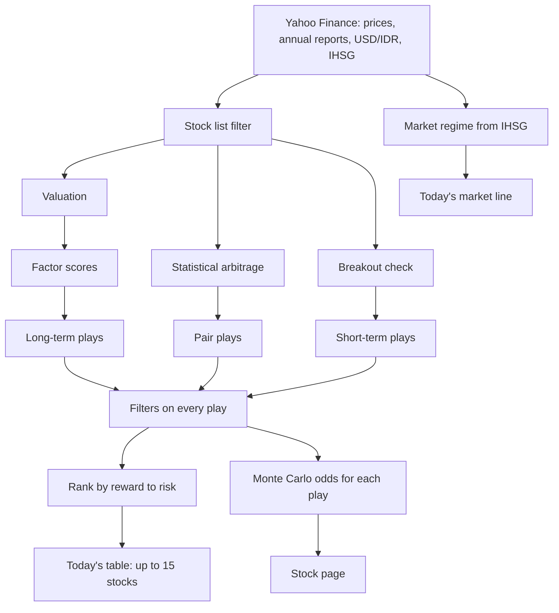
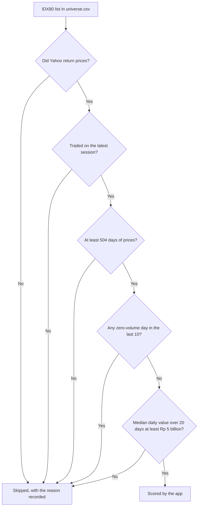
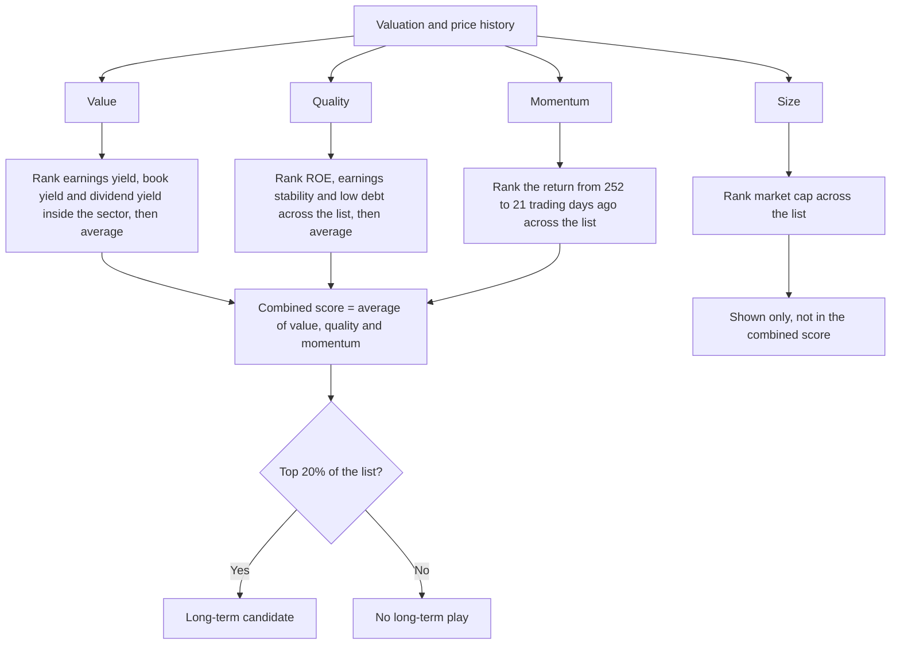
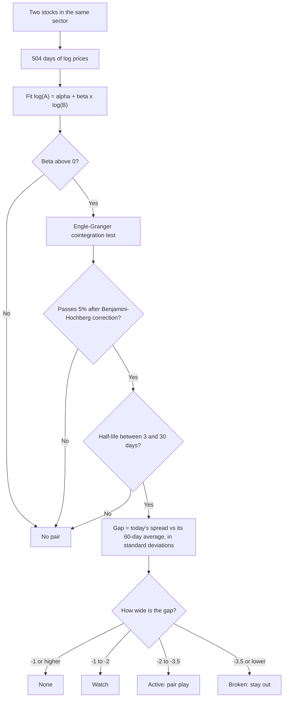
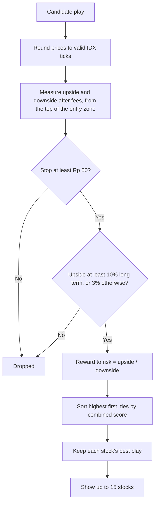
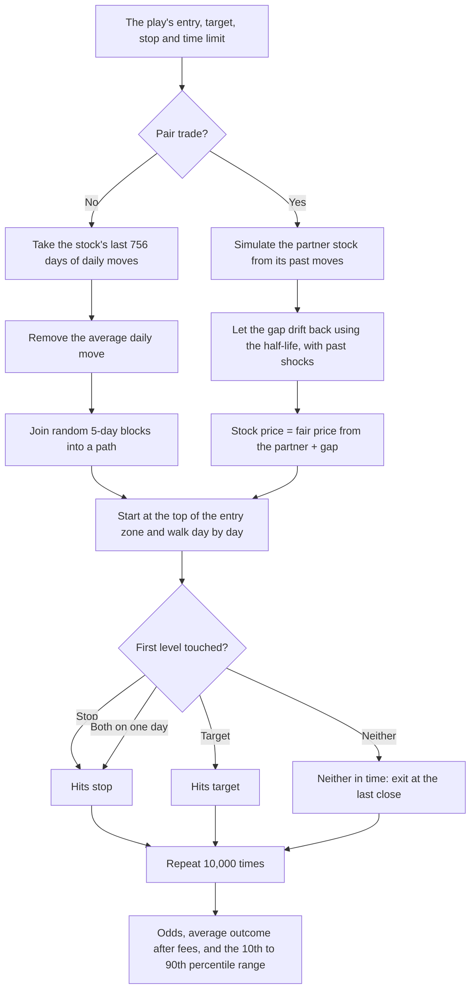
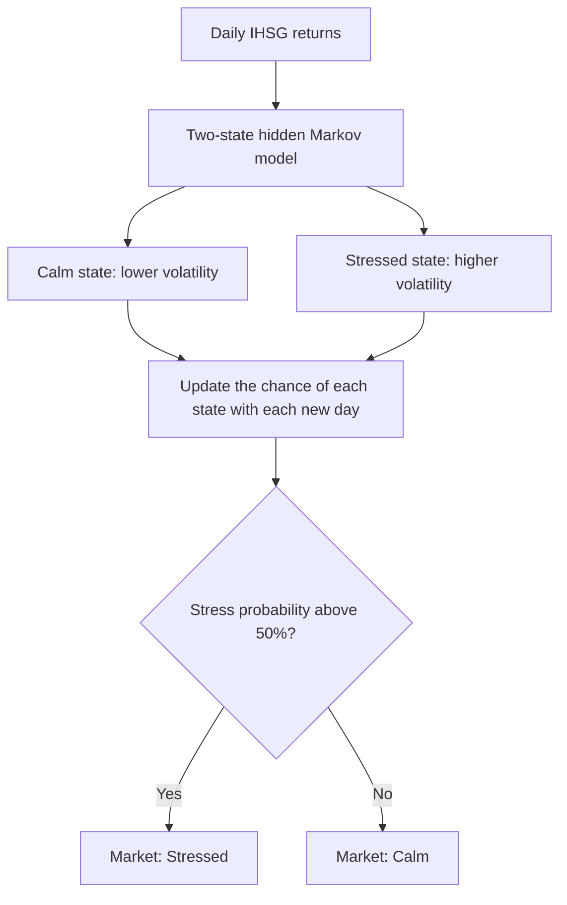

# IDX Quant

A personal app that ranks Indonesian (IDX80) stocks after each trading day, using factor scores, statistical arbitrage, Monte Carlo simulation and market regime detection. Each pick comes with a playbook.

This is model output, not personal financial advice. It doesn't know your money or risk limits, and it can be wrong. The app has no login, so anyone with its link can open it. Don't publish the link: sharing recommendations publicly or with paying users may fall under Indonesian investment advice rules.

## Run it on your computer

On Windows, double-click `run.bat`. It sets everything up on the first run and opens http://127.0.0.1:8765.

## Run the tests

```bash
python -m venv .venv
.venv/Scripts/pip install -r requirements-dev.txt
.venv/Scripts/python -m pytest
```

## How it works

Every number below is the current default from `idxquant/config.py`. These are starting points, not tuned results. The app's **How it works** page and **?** icons explain each figure in more detail.

### The daily flow

Each refresh runs this once, and the result is saved as that day's snapshot. Monte Carlo and the market regime add information for you to read, but neither changes which stocks are picked or how they rank.



### Stock list



If more than 30% of stocks return no data, the refresh counts as failed and the last good result stays on screen.

### Valuation

Figures use today's close and the latest annual report. US dollar reporters are converted at the latest USD/IDR rate.

| Figure | How it's calculated |
|---|---|
| PE | Close / earnings per share. Blank if earnings are zero or negative. |
| PBV | Close / (equity / shares). Blank if equity is negative. |
| P/S | Market cap / revenue |
| EV/EBITDA | (Market cap + debt - cash) / EBITDA |
| Earnings yield | Earnings per share / close |
| Free cash flow yield | Free cash flow / market cap |
| Dividend yield | Rupiah dividends per share over the last 365 days / close |
| Graham value | Square root of (22.5 x EPS x book value per share) |
| Margins | Gross profit, operating income and net income, each / revenue |
| ROE and ROA | Net income / equity, and net income / total assets |
| Growth | Latest year / previous year - 1, and EPS growth per year over the available reports |
| Debt to equity | Total debt / equity |
| Net debt to EBITDA | (Debt - cash) / EBITDA |
| Current ratio | Current assets / current liabilities |
| Interest cover | Operating income / interest expense |
| Payout ratio | Dividends per share / earnings per share |

EV/EBITDA, free cash flow yield, net debt to EBITDA, current ratio and interest cover don't apply to banks and finance companies, so they show a dash. Sector medians need at least 3 stocks with a usable value.

### Factor scores

Each score is a percentile from 0 to 100, so 85 means the stock beats about 85% of the list.



- **Value:** a sector with fewer than 3 scored stocks ranks against the whole list. Missing parts are skipped.
- **Quality:** earnings stability is average net income / its standard deviation, and needs at least 3 years. Banks skip the debt part.
- **Momentum:** the latest month is left out because very recent moves often reverse. Dividends are included.
- **Combined score:** it's blank if value, quality or momentum is missing.

### Statistical arbitrage



Half-life comes from regressing the daily change in the spread on the previous day's spread: half-life = ln(2) / -slope. Pairs are re-tested at every refresh.

A true pair trade also shorts the expensive stock, but shorting on IDX is restricted. The app only buys the cheap stock, so these trades still carry market risk.

### Plays and ranking

| | Long term | Short term | Pair trade |
|---|---|---|---|
| **Qualifies when** | Combined score in the top 20%, with financials under 18 months old | Close above its 50-day average and the previous 20 days' highest high, on volume above their average | Gap is Active |
| **Entry** | From 2% below the close up to the close | From the close up to 1% above | From the close up to 1.5% above |
| **Target** | Average of sector PE x EPS and sector PBV x book value, capped at +35% | Close + 3 x ATR(14) | Price where the gap reaches -0.5 |
| **Stop** | 25% below the top of the entry zone | Close - 1.5 x ATR(14) | Price where the gap reaches -3.5 |
| **Time limit** | 12 months | 2 weeks | 2 x half-life, in trading days |



Fees are 0.15% to buy and 0.25% to sell. A quiet day can give a short list or none at all.

### Monte Carlo

Every play is simulated 10,000 times, so you can see how it might end. This runs after the picks are chosen and doesn't change them.



- **Why the average move is removed:** a past trend isn't evidence of a future one, so the odds reflect how much a stock moves, not whether the signal is any good.
- **Time limits:** 260 trading days for long term, 10 for short term, and 2 x half-life for pairs.
- **Repeatable odds:** each simulation is seeded by stock, play and date, so refreshing the same day gives the same odds.
- **Accuracy check:** the Results page compares past predictions, made using only earlier data, with what really happened. Pair odds aren't checked, because there are too few past trades.

### Market regime



The model needs 504 days of data to start and is refitted every 63 trading days. Each day's reading uses only data up to that day, so it reacts after a move starts and doesn't predict turns. The regime is for information only and doesn't change the picks.

### Backtest

Short-term, pair and momentum signals are tested on up to 10 years of prices. Decisions use only earlier data, trades enter at the next day's open, and fees are included. Backtests re-run every 30 days.

Value and quality can't be tested, because free data has only about 4 years of annual reports. The tests also use today's index members, so companies that collapsed are missing, which flatters the results.

## Settings

| Variable | Default | Purpose |
|---|---|---|
| `HOST` | `127.0.0.1` | Address to serve on. The Dockerfile sets `0.0.0.0`. |
| `PORT` | `8765` | Port to serve on. Most hosts set this for you. |
| `DATA_PATH` | `data/idxquant.sqlite` | Database location. The Dockerfile sets `/data/idxquant.sqlite`. |

On any address other than this computer, the app runs in server mode. It refreshes by itself, checking every 10 minutes and fetching new data after 17:00 WIB on weekdays, and the Refresh button runs at most once every 10 minutes.

## Deploy

The app needs one always-on instance and persistent storage. Don't run more than one copy, because they'd share one SQLite database. Plans that sleep when idle or wipe files between restarts won't work.

1. Put the project in a private GitHub repository.
2. Create a service from that repository on a host that builds Dockerfiles. Start with about 1 GB of memory.
3. Attach a persistent volume mounted at `/data`.
4. Set the health check path to `/health`.
5. Run this in the host's shell to confirm Yahoo isn't blocking the server:

   ```bash
   python -m idxquant.check
   ```

6. Open the site and wait for the first fetch to finish. It takes a few minutes.

If the check fails, Yahoo is probably blocking the host's addresses. Try another host or region, or use a paid data source by replacing `idxquant/yahoo.py`, which is the only module that fetches data.

## Keeping it up to date

- **Stock list:** edit `idxquant/universe.csv` by hand when the IDX80 changes. The next change is due after 29 January 2027.
- **Rules:** thresholds are in `idxquant/config.py`.
